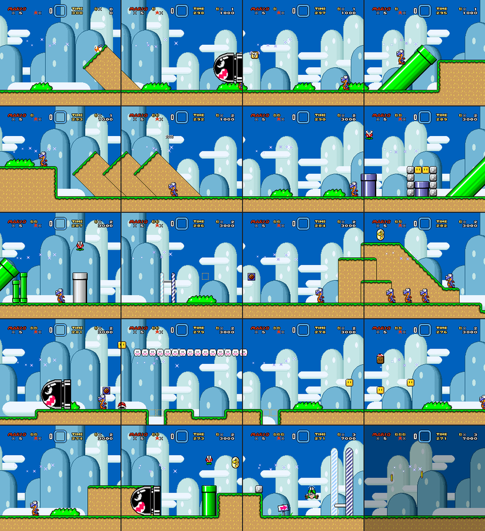

# snes-lab

**An MCP server for taking SNES games apart and modding them**, with its byte-level core in Rust.
It gives an AI agent (or you, from a script) the tools a ROM hacker reaches for: ROM and BPS
patch tools, a 65816 disassembler and caller search that work on any ROM, an assembler wrapper,
scriptable emulator sessions with memory watches, a headless debugger, an experiment runner, a bot
that searches for controller inputs, and Super Mario World recipes on top.



<sub>One call to `smw_level_sheet("105")`: snes-lab boots the game in Snes9x, enters the level and
glides the camera across it, one frame per screen. Rendered from your own ROM; no game data is in
this repository.</sub>

## What it replaces

ROM hacking has traditionally meant juggling desktop tools by hand: a hex editor, a debugging
emulator (bsnes-plus, Mesen), a disassembler, an assembler (Asar), a patcher (Floating IPS) and
game-specific editors such as Lunar Magic. Each is interactive and none can be driven by a program.

snes-lab wraps that workflow as tools an agent can call and chain. "Who writes this RAM address?",
"which bytes are code?", "can Mario finish this level?" become single calls with structured
answers, and every patching tool writes to a new file, never the original.

## Features

- **ROM tools for any game:** header, mapping (LoROM, HiROM, ExHiROM, SA-1), checksum and CRC;
  CPU address ⇄ file offset; read and patch bytes (checksum fixed); make and apply BPS patches.
- **Code:** a 65816 disassembler that follows REP/SEP and prints the M/X flags it assumed on every
  line; a whole-ROM search for callers and long-address references; Asar assembly onto a copy with
  the changed ranges and a BPS.
- **Emulator sessions (Snes9x via libretro):** open, run frames with input like `RIGHT+Y+B`, read
  and write WRAM/SRAM/VRAM, savestates, screenshots, run-until-a-memory-condition, per-frame
  watches, VRAM tile sheets. Each session is its own process.
- **Debugger (MesenCE, headless):** read/write/exec watches with registers and the writing
  instruction, on the main CPU or the SA-1; code/data logs that feed the disassembler the real M/X
  flags.
- **Lab:** `experiment_run` tries many ROM/RAM variants and groups identical screenshots;
  `route_search` beam-searches controller inputs to a RAM goal and `route_replay` proves the route.
- **Super Mario World:** decode any level's objects and sprites, jump straight into any level,
  tour it, or capture a whole level as one contact sheet.
- **Disassembly lookup:** RAM and ROM labels with notes from SMWDisX, and regex search over it.
- **snes-kit (Rust):** address maths, headers, BPS, HAL Laboratory compression (byte-identical to
  exhal/inhal) and SMW level encoding, used from Python through PyO3.

[docs/smw-notes.md](docs/smw-notes.md) is a field guide for agents and people: which tool answers
which question, SMW facts, and the gotchas found the hard way.
[docs/design.md](docs/design.md) explains the design choices and what was rejected.

## Quick start

**You need:** Python 3.14 and [uv](https://docs.astral.sh/uv/), a Rust toolchain (`cargo`) to
build snes-kit, and git, make and a C++ compiler to build the emulator core. You also need your own
ROM dumps: snes-lab ships no game data.

```sh
git clone https://github.com/avoliva/snes-lab.git && cd snes-lab
uv sync                       # builds the Rust extension too
scripts/build_core.sh         # Snes9x libretro core -> ~/.cache/snes-lab
scripts/fetch_smwdisx.sh      # SMW disassembly, for disasm_* and smw_*
scripts/build_asar.sh         # optional: Asar 1.91, for asm_patch
scripts/fetch_mesen.sh        # optional: MesenCE (Apple Silicon), for mesen_*
export SNES_LAB_ROM=/path/to/your/SuperMarioWorld.sfc   # clean USA 1.0, CRC32 B19ED489
```

Then register it with your MCP client. Most clients take a JSON entry like this:

```json
{
  "mcpServers": {
    "snes-lab": {
      "command": "uv",
      "args": ["run", "--directory", "/path/to/snes-lab", "snes-lab"],
      "env": { "SNES_LAB_ROM": "/path/to/your/SuperMarioWorld.sfc" }
    }
  }
}
```

Try asking your agent: *"Disassemble 20 lines at the reset vector"*, *"Which routines call
$00:8494?"* or *"Show me level 105 as a contact sheet."* The tools also work from Python:

```python
from snes_lab import server as lab
lab.rom_info("game.sfc")
lab.rom_disasm("game.sfc", "$00:8000", count=14, m8=True, x8=True)
```

```text
$00:8000  78           M8 X8    SEI
$00:8001  9C 00 42     M8 X8    STZ $4200
$00:8004  9C 0C 42     M8 X8    STZ $420C
...
$00:801D  C2 38        M8 X8    REP #$38
$00:801F  A9 00 00     M16 X16  LDA #$0000
```

### Settings

| Variable | Default |
| --- | --- |
| `SNES_LAB_ROM` | none: the default ROM for SMW tools |
| `SNES_LAB_CORE` | `~/.cache/snes-lab/snes9x_libretro.{dylib,so}` |
| `SNES_LAB_DISASM` | `~/.cache/snes-lab/SMWDisX` |
| `SNES_LAB_ASAR` | `asar` on PATH, then `~/.cache/snes-lab/asar` |
| `SNES_LAB_MESEN` | `~/.cache/snes-lab/mesen/Mesen.app` (a MesenCE binary or .app in portable mode) |
| `SNES_LAB_OUT` | `~/.cache/snes-lab/out` (screenshots, sheets, patches, routes) |
| `SNES_CORPUS` | none: a folder of your own ROM dumps, for the romset test and sweep |

## Development

```sh
make check    # cargo fmt, clippy and test; ruff; mypy --strict on the bindings; pytest
```

Tests that need a ROM, the emulator core, Mesen or the exhal tools skip when those aren't set
(`SNES_LAB_ROM`, `SNES_LAB_CORE`, `KSS_ROM`, `EXHAL_DIR`, `FLIPS`, `SNES_CORPUS`), so CI runs the
rest. With them set locally, 98 Python tests and 28 Rust tests run.

| Path | What |
| --- | --- |
| `src/snes_lab/` | The MCP server: `server.py` (tools), `rom.py`, `cpu65816.py` (disassembler, xrefs), `disasm.py`, `asar.py`, `core.py` (ctypes libretro), `worker.py` / `sessions.py` (one process per session), `watch.py`, `tiles.py`, `smw.py`, `experiment.py`, `route.py`, `mesen.py` + `mesen_job.lua` |
| `crates/snes-kit/` | Rust: `addr`, `header`, `bps`, `hal`, `smw`, `crc32` |
| `crates/snes-kit-py/` | PyO3 bindings and `snes_kit.corpus` (read a folder or .zip romset) |
| `scripts/` | Build and fetch the emulator core, Asar, Mesen and SMWDisX; the romset sweep |
| `tests/`, `tests/kit/` | Python tests for the server and for snes-kit |

## License

[MIT](LICENSE). The HAL compression code is derived from exhal/inhal by Devin Acker (MIT,
[LICENSES/exhal.txt](LICENSES/exhal.txt)). Super Mario World and other games are trademarks of
their owners; snes-lab is not affiliated with Nintendo and contains no game data.
